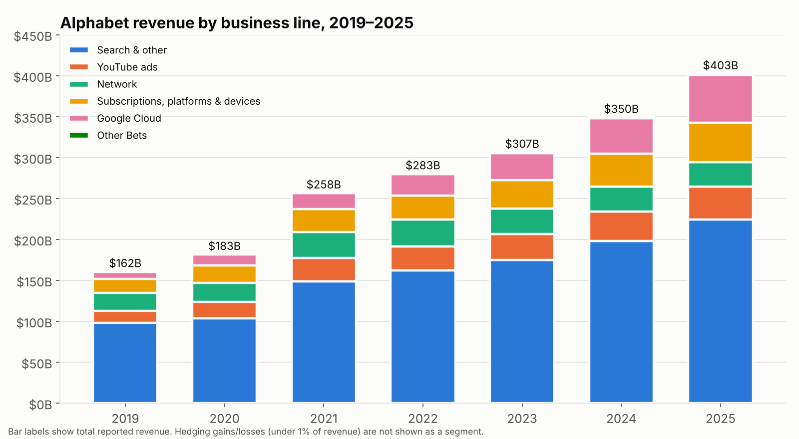
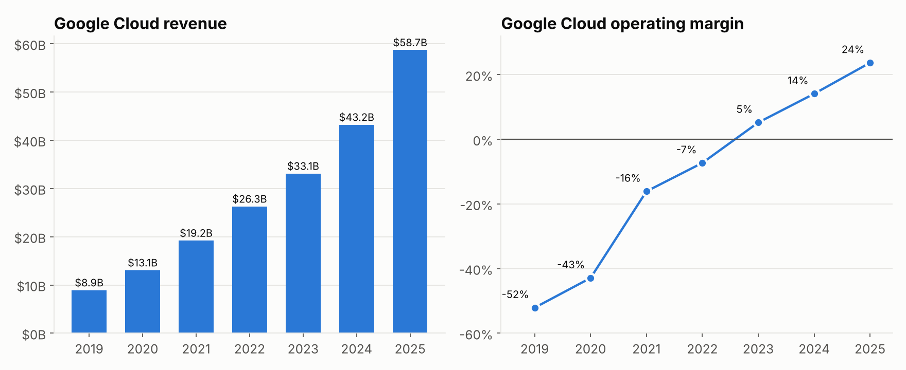
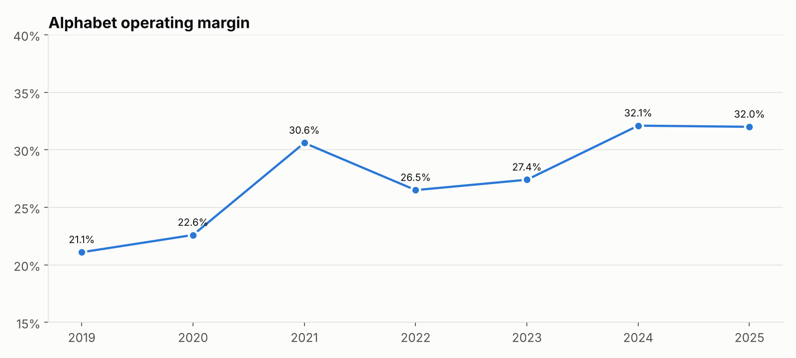
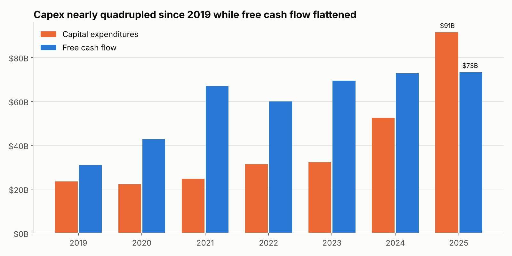

# Alphabet (Google) Financial Performance Analysis, FY2019–FY2025

**Tools:** SQL (SQLite, written to work in BigQuery with small changes) · Tableau Public · Python (pandas, matplotlib) · Excel-style financial ratios
**Data:** Alphabet Form 10-K filings from SEC EDGAR, 7 fiscal years, all figures in $ millions

---

## The business question

Alphabet's revenue grew from **$162B to $403B** between 2019 and 2025. This project answers four questions a finance analyst would ask:

1. **Where is the growth coming from?** Which business lines drive revenue, and how is the mix shifting?
2. **Is the company getting more profitable?** How have margins and the cost structure changed?
3. **Has Google Cloud become a real profit engine?** When did it turn profitable, and how fast is the margin improving?
4. **What does the AI investment cycle cost?** How is record capital spending affecting free cash flow?

---

## Key findings

### 1. Search still drives over half of all growth, but Cloud is the fastest-growing line
| Business line | 2019 rev | 2025 rev | 6-yr CAGR | Share of total $ growth |
|---|---|---|---|---|
| Search & other | $98.1B | $224.5B | 14.8% | 52.3% |
| Google Cloud | $8.9B | $58.7B | **36.9%** | 20.6% |
| Subscriptions, platforms & devices | $17.0B | $48.0B | 18.9% | 12.8% |
| YouTube ads | $15.1B | $40.4B | 17.7% | 10.4% |
| Google Network | $21.5B | $29.8B | 5.5% | 3.4% |

Google Network (ads on partner sites) has **declined three years in a row** (2023–2025), the only shrinking line.



### 2. Google Cloud went from a 52% loss to a 24% profit margin in six years
Cloud lost **$4.6B** in 2019. It turned profitable in 2023 and earned **$13.9B** in operating income in 2025, a **23.7% margin**. Cloud's share of Alphabet's total operating income rose from 2.0% (2023) to 10.8% (2025).



### 3. Operating margin rose about 11 points, mainly from spending discipline
Operating margin went from **21.1% (2019) to 32.0% (2025)**. The biggest drivers:
- **Sales & marketing** fell from 11.4% to 7.1% of revenue
- **Cost of revenues** fell from 44.4% to 40.3% of revenue
- **Revenue per employee** grew 55%, from $1.36M to $2.11M, while headcount stayed flat at about 190K from 2022 to 2025



### 4. AI infrastructure spending is now absorbing nearly all new cash flow
Capital expenditures jumped **63% in 2024 and 74% in 2025**, reaching **$91.4B (22.7% of revenue)**. Operating cash flow grew $39B in 2025, but capex grew $39B too, so **free cash flow stayed flat at about $73B** (2024: $72.8B, 2025: $73.3B). Capex is now **4.3x depreciation**, so depreciation costs will keep rising for years.



---

## What I'd tell a finance leader
- **Watch Cloud margin as the payoff metric for AI spend.** Cloud is the clearest place where AI capex turns into revenue; its margin trend shows whether the investment is earning a return.
- **Plan for depreciation pressure.** With capex running 4x depreciation, rising depreciation will weigh on operating margin in future years, even if revenue keeps growing.
- **Free cash flow, not net income, is the constraint to watch.** Net income grew 32% in 2025 while free cash flow grew under 1%.

---

## How the analysis works

```
data/raw/            3 CSV files typed in from the 10-K tables
scripts/build_database.py   checks the numbers tie out, loads them into SQLite
sql/analysis_queries.sql    8 business-question queries
scripts/run_analysis.py     runs each query, saves results to outputs/
scripts/make_charts.py      builds the README charts
data/processed/      clean files for the Tableau dashboard
tableau/TABLEAU_GUIDE.md    how the dashboard is built
```

**Data quality checks** (run every time, the build stops if any fail):
- Revenue lines add up to reported total revenue, every year
- Revenue minus all expense lines equals reported operating income, every year
- Segment operating income adds up to total operating income, every year

**SQL techniques used:** window functions (`LAG`, `RANK`, `SUM() OVER()`), CTEs, conditional aggregation (`CASE WHEN` pivots), multi-table joins, CAGR calculation.

### Run it yourself
```bash
pip install -r requirements.txt
python scripts/build_database.py
python scripts/run_analysis.py
python scripts/make_charts.py
```

---

## Data notes
- **Source:** Alphabet 10-K filings for FY2021, FY2022, FY2023, and FY2025 (SEC EDGAR).
- **Segment profit restatement:** In 2023, Alphabet moved AI research costs (Google DeepMind) out of the Services and Cloud segments into "Alphabet-level activities" and restated 2022. Segment profits for 2019–2021 are as originally reported and are not fully comparable with 2022 onward. Total company figures are not affected.
- **2025 Other Bets loss** includes a one-time $2.1B Waymo stock compensation charge.
- **"Google subscriptions, platforms, and devices"** was called "Google other" before 2022. It is the same line.
- **EPS** is adjusted for the 20-for-1 stock split in July 2022.
- **Free cash flow** = operating cash flow − purchases of property and equipment.

---

## About this project
I chose the questions, checked the figures against the 10-K filings, and built the Tableau dashboard. I used Claude Code (an AI coding assistant) to help write the Python scripts and draft SQL, then reviewed and ran every query myself.

**Trupti** · B.A. Psychology & Mathematics, University of Minnesota · www.linkedin.com/in/trupti-singh-ab8973292
